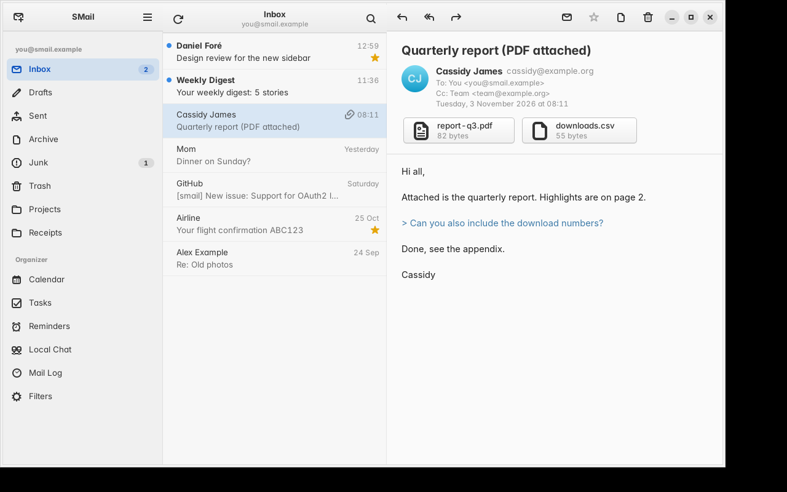
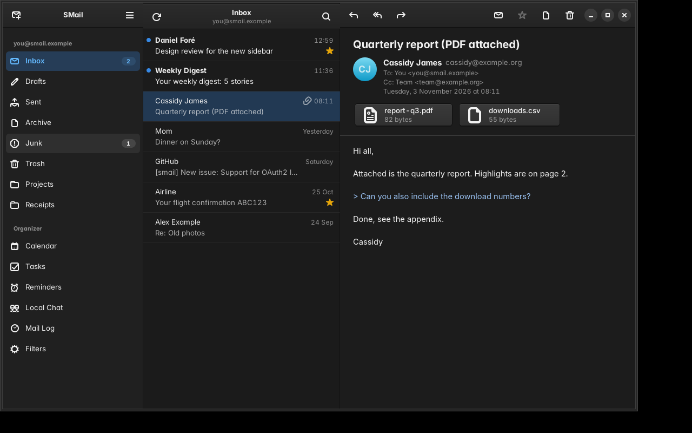
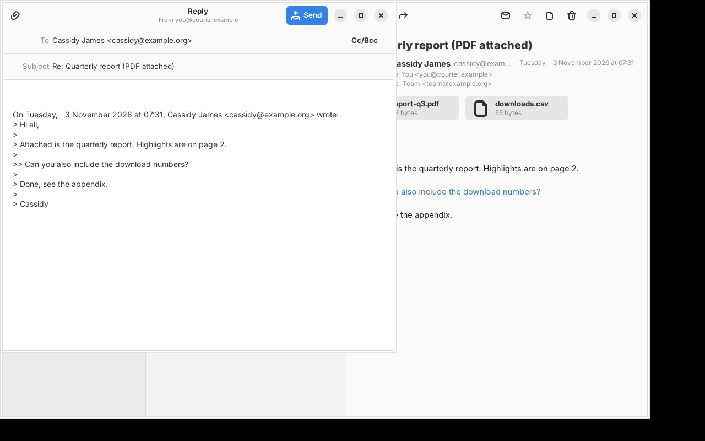
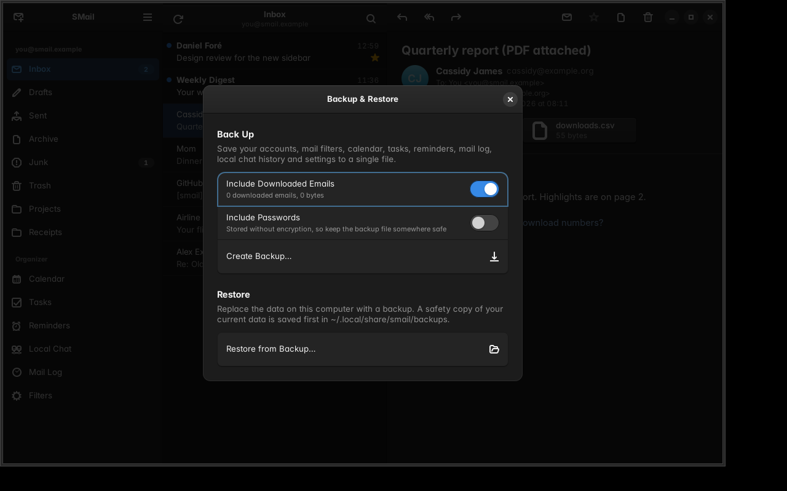
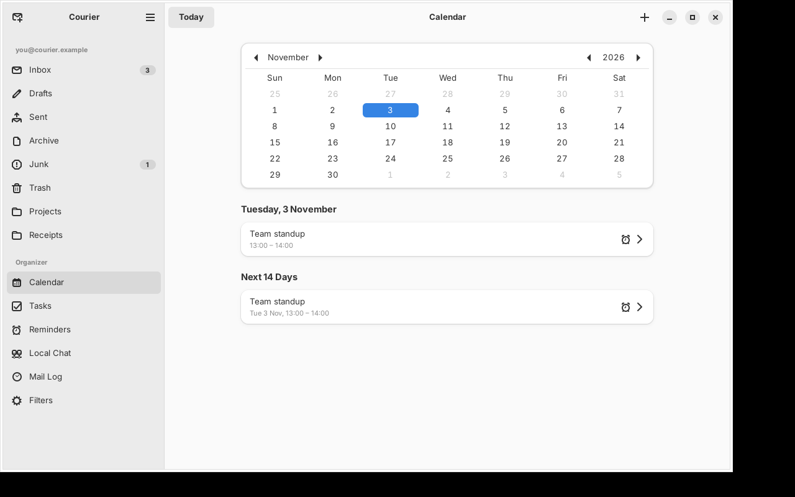
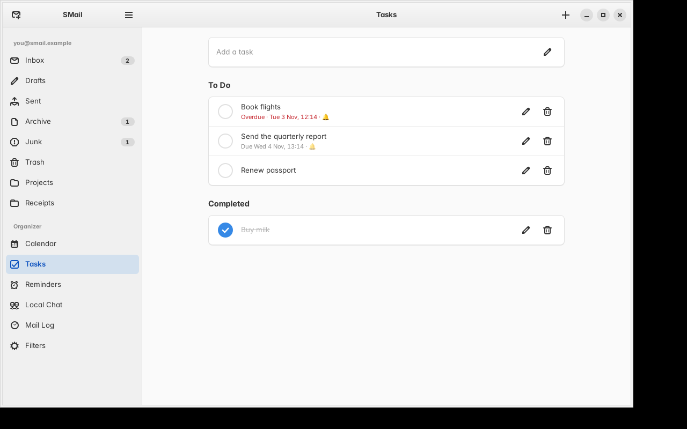
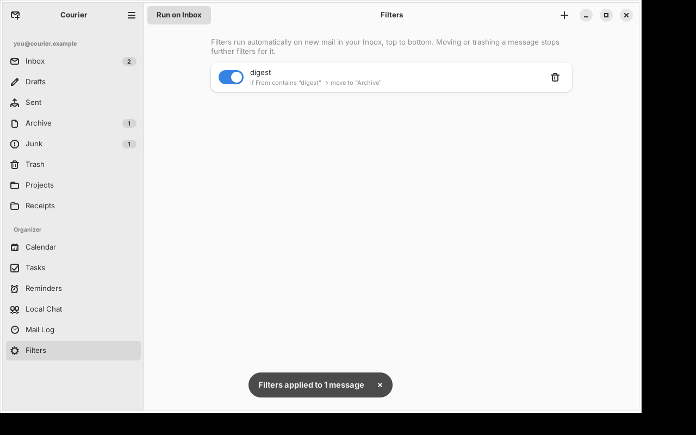
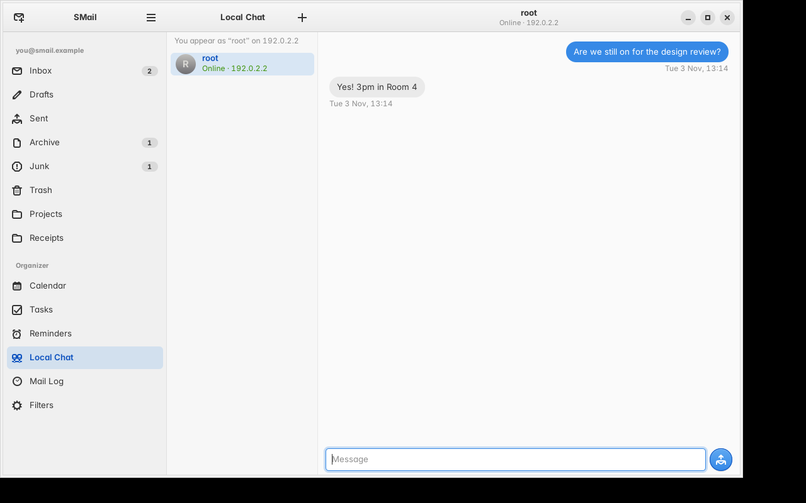

# SMail

[](https://github.com/udhayakumar-in8/smail-client/actions/workflows/ci.yml)
[](https://github.com/udhayakumar-in8/smail-client/releases/latest)
[](LICENSE)

A native email client for Linux written in **C** with **GTK 4** and **libadwaita**, modelled on the
three-pane layout of elementary OS Mail.

| Matte White | Matte Black |
|---|---|
|  |  |

## Styles: Matte White and Matte Black

Choose a style in **Main Menu → Style**:

- **Matte White** and **Matte Black** are styled after elementary OS: the **Inter** typeface
  throughout, the Blueberry blue accent, softly graded buttons with a fine border and drop shadow,
  borderless icon buttons in header bars, blue suggested-action and red destructive-action buttons,
  white or near-black bordered entries, and accent-tinted selection in the sidebar and message list.
- **System Style** uses the standard libadwaita look and follows your desktop's light/dark setting.

Your choice is remembered, and it is included in backups.



## Features

- **Three-pane adaptive layout**: folders, message list and reading pane, built with
  `AdwNavigationSplitView` and breakpoints. It collapses to one pane at a time on narrow or phone-sized windows.
- **IMAP**: SSL/TLS, STARTTLS or plain connections. Special-use folder detection
  (Inbox, Sent, Drafts, Archive, Junk, Trash), unread counts, Unicode (UTF-7) folder names,
  `MOVE`/`UIDPLUS` with fallbacks, and reconnecting automatically when the connection drops.
- **Reading**: HTML mail is rendered in a sandboxed WebKitGTK view with **JavaScript disabled**
  and a strict Content-Security-Policy. **Remote images and tracking pixels are blocked** until
  you click *Show Images*. Inline `cid:` images and plain-text mail with linkified URLs and
  coloured quotes are supported. Dark mode applies to plain-text mail.
- **Attachments**: shown with type icons and sizes; click one to save it.
- **Composer**: new message, reply, reply-all (removes your own address), and forward
  (keeps the original attachments). Supports Cc/Bcc, file attachments, and correct
  `In-Reply-To`/`References` threading headers. It asks before discarding a draft.
- **Sending** over SMTP (libcurl). A copy is saved to your Sent folder, except on Gmail and
  Outlook, which do that themselves.
- **Organising**: star, mark read/unread, archive and move to Trash (deletes permanently when
  already in Trash). Changes appear instantly and roll back if the server refuses them.
- **Accounts**: multiple accounts, with presets for Gmail, Outlook, Yahoo, iCloud, Fastmail, Zoho and
  Proton Bridge, and a login test before saving. Passwords are stored in the system keyring
  (libsecret), never in the config file.
- **Search** within the loaded folder, automatic refresh every 5 minutes, and keyboard shortcuts.
- **Demo mode** (`--demo`) with sample mail, so you can try the app without an account.

## Downloaded emails are kept

Every message you open is saved as a full `.eml` file in
`~/.local/share/smail/mail/<account>/<folder>/`. After that it opens instantly from the local
copy, even offline, and the Mail Log links to it. (The `--demo` mailbox is never saved.)

## Backup & Restore

**Main Menu → Backup & Restore…** saves everything SMail keeps on this computer to one
`.smailbackup` file:

- email accounts (server settings, and optionally the passwords)
- mail filters
- calendar events, tasks and reminders
- the mail log and local chat history
- settings, including the style
- every downloaded email and every copy of sent mail (optional)



**Restore** shows what a backup contains before anything changes. It saves a safety copy of your
current data to `~/.local/share/smail/backups/` and then replaces your local data with the
backup's. Passwords are restored into the keyring if the backup includes them; otherwise you
enter them in Account Settings. Your Local Chat identity stays with this computer.

Passwords in a backup are **not encrypted**, so only include them if you keep the file somewhere safe.

## Organizer and local features

Everything below is stored on your computer in a SQLite database
(`~/.local/share/smail/smail.db`). None of it is sent to your mail server.

| Calendar | Tasks |
|---|---|
|  |  |
| **Filters** | **Local Chat** |
|  |  |

- **Calendar**: month view with a day agenda and the next 14 days. Events have a title, location,
  start/end time, notes and an optional reminder (at start, or 5 min to 1 day before).
- **Tasks**: quick-add to-dos, due dates, an optional reminder at the due time, and a Completed list.
- **Reminders**: one-off reminders, plus the ones created by events and tasks. When one is due you
  get a desktop notification and an in-app banner with **Snooze 10 minutes**. Reminders only fire
  while SMail is running.
- **Filters**: rules such as *If From contains "bank" → move to "Finance"*. Fields are From, To,
  Subject or any of them; conditions are contains, doesn't contain, is, starts with and ends with;
  actions are move to folder, mark as read, star and move to Trash. Rules run automatically on **new
  mail arriving in the Inbox**, top to bottom, and **Run on Inbox** applies them to existing mail.
- **Mail Log**: details of every message that arrives in your Inbox (sender, recipients,
  subject, date, account, folder) and every message you send are **saved automatically**. Sent
  messages also keep a full `.eml` copy in `~/.local/share/smail/sent-mail/`. The log can be
  searched, filtered by received/sent, and exported to CSV.
- **Local Chat**: message other people running SMail on the same Wi-Fi/LAN, with no internet or
  server needed. Computers find each other automatically (UDP broadcast on port 47820) and messages
  go directly over TCP port 47821. If broadcasts are blocked, add someone with **+** and their IP
  address. Chat history is kept locally. Traffic is **not encrypted**, so use it only on networks
  you trust, and allow those ports in your firewall.

New mail is detected when SMail refreshes: at start-up, every 5 minutes, or when you press F5.
The first sync of an account records what is already in the Inbox. After that, each new message
is logged, filtered and announced with a notification.

## Installing

Download from the [latest release](https://github.com/udhayakumar-in8/smail-client/releases/latest).

**Arch Linux:** install the ready-made package:

```bash
sudo pacman -U smail-*.pkg.tar.zst
```

Or build it yourself with the release's `PKGBUILD`. Put it in an empty folder, then:

```bash
makepkg -si
```

**Ubuntu 24.04 or newer:**

```bash
sudo apt install ./smail_*.deb
```

On other distributions, build from source as described below.

## Building

Requirements: GTK ≥ 4.12, libadwaita ≥ 1.5, WebKitGTK 6.0, GMime 3, libsecret, libcurl, SQLite 3, json-glib ≥ 1.6, Meson.

**Ubuntu 24.04+ / Debian 13+**
```bash
sudo apt install build-essential meson libgtk-4-dev libadwaita-1-dev libwebkitgtk-6.0-dev libgmime-3.0-dev libsecret-1-dev libcurl4-openssl-dev libsqlite3-dev libjson-glib-dev glib-networking
```

**Fedora**
```bash
sudo dnf install gcc meson gtk4-devel libadwaita-devel webkitgtk6.0-devel gmime30-devel libsecret-devel libcurl-devel sqlite-devel json-glib-devel glib-networking
```

**Arch Linux**
```bash
sudo pacman -S base-devel meson gtk4 libadwaita webkitgtk-6.0 gmime3 libsecret curl sqlite json-glib glib-networking
```

Then:
```bash
meson setup build
```
```bash
ninja -C build
```
```bash
./build/smail            # or: ./build/smail --demo
```

Install system-wide with `sudo ninja -C build install`.

### Gmail, Outlook, iCloud and Yahoo

These providers need IMAP turned on and, with two-factor authentication enabled, an
**app password** instead of your normal password. OAuth2 sign-in isn't implemented yet.

## Keyboard shortcuts

| Action | Shortcut | Action | Shortcut |
|---|---|---|---|
| Compose | <kbd>Ctrl</kbd>+<kbd>N</kbd> | Archive | <kbd>A</kbd> |
| Reply | <kbd>Ctrl</kbd>+<kbd>R</kbd> | Move to Trash | <kbd>Delete</kbd> |
| Reply all | <kbd>Ctrl</kbd>+<kbd>Shift</kbd>+<kbd>R</kbd> | Star / unstar | <kbd>S</kbd> |
| Forward | <kbd>Ctrl</kbd>+<kbd>L</kbd> | Mark read / unread | <kbd>U</kbd> |
| Send (composer) | <kbd>Ctrl</kbd>+<kbd>Enter</kbd> | Search | <kbd>Ctrl</kbd>+<kbd>F</kbd> |
| Refresh | <kbd>F5</kbd> | All shortcuts | <kbd>Ctrl</kbd>+<kbd>?</kbd> |

## Code layout

```
src/
  main.c                  app startup, CSS, About dialog, shortcuts
  smail-window.c          the three-pane window, actions, account lifecycle
  smail-message-view.c    reading pane (header, attachments, sandboxed WebKit body)
  smail-composer.c        compose / reply / forward window, builds MIME with GMime
  smail-account-dialog.c  add/edit account form with provider autodetection
  smail-accounts.c        accounts.ini persistence + libsecret passwords
  smail-backend.c         async API: every operation runs on a worker thread (GTask)
  smail-imap.c            small IMAP4rev1 client on GIO sockets/TLS (literals, UTF-7)
  smail-smtp.c            SMTP submission via libcurl
  smail-demo.c            in-memory sample mailbox for --demo
  smail-types.c           Account/Folder/Message types and MIME parsing
  smail-util.c            date formatting, HTML↔text helpers
  smail-store.c           SQLite: events, tasks, reminders, filters, mail log, chat history
  smail-automation.c      filter matching and mail log entries
  smail-lan.c             LAN chat: UDP discovery + JSON-over-TCP messages
  smail-organizer.c       Calendar, Tasks and Reminders pages
  smail-mail-tools.c      Filters and Mail Log pages
  smail-chat-page.c       Local Chat page
  smail-ui.c              shared widgets (date-time picker, page helpers)
  smail-backup.c          single-file backup and restore (SQLite)
  smail-backup-dialog.c   Backup & Restore dialog
  smail-theme.c           System / Matte White / Matte Black styles
tests/test-imap.c         IMAP/SMTP/MIME tests (offline + live server)
tests/test-local.c        database, filters, mail log and LAN chat tests
tests/test-backup.c       downloaded-mail store and backup/restore round trips
```

The UI never blocks. `SMailBackend` serialises access to each account's IMAP connection with
a mutex, runs the work on a thread, and returns results to the main loop. If you switch folders
or messages mid-request, the old request is cancelled or its result is discarded.

## Tests

```bash
meson test -C build      # UTF-7, MIME, database, filters, mail log, LAN chat, backup/restore
```

To try Local Chat with two copies on one computer, give the second copy its own data folders and
message port:

```bash
XDG_DATA_HOME=/tmp/b/data XDG_CONFIG_HOME=/tmp/b/config SMAIL_LAN_PORT=47831 ./build/smail --demo
```

To also test against a real IMAP server (it clears and fills INBOX, Archive, Trash and Sent, so **use a
throwaway test account**) and an SMTP server:

```bash
SMAIL_TEST_IMAP=127.0.0.1:143 SMAIL_TEST_USER=test SMAIL_TEST_PASS=secret SMAIL_TEST_SMTP=127.0.0.1:25 ./build/test-imap
```

## Releases

The [CI workflow](.github/workflows/ci.yml) builds and tests every push and pull request on
**Ubuntu 24.04** and **Arch Linux** (in the official `archlinux` container), with warnings treated
as errors. On each distro it:

- runs the unit tests, and on Ubuntu the IMAP/SMTP tests against a temporary Dovecot server;
- runs `tests/smoke-gui.sh`, which starts the app in every style on a virtual display, fails on
  GTK/libadwaita warnings, and checks the screenshot to confirm the style applied;
- builds the `.deb` and the Arch package (`makepkg`), installs the Arch package with `pacman`, and
  uploads both packages as build artifacts.

To publish a release, change the version in `meson.build`, add a section for it to
`CHANGELOG.md`, and push to `main`. The [release workflow](.github/workflows/release.yml) sees
the version has no release yet. It then builds and tests everything again, creates the
`v<version>` tag, and publishes a GitHub release with the source tarball, the Arch Linux package
and its `PKGBUILD`, the Ubuntu 24.04 `.deb`, `SHA256SUMS` and the changelog notes. Pushing a matching `v<version>` tag yourself works too.

## Not yet implemented

- OAuth2 login (Gmail/Outlook currently need app passwords)
- Server-side search, plus paging past the newest 100 messages in a folder
- Conversation threading, IMAP IDLE push (new mail is found by polling every 5 minutes)
- Recurring calendar events, and import/export of calendars (iCalendar) and contacts
- Encrypted Local Chat, group chats and file transfer
- Saving drafts to the server and composing HTML (rich text)
- Offline cache: messages are fetched from the server each time
